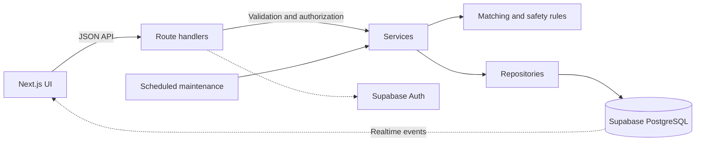

# FoodBridge

FoodBridge is a government-supported platform that connects surplus food with nearby communities that need it. Restaurants, caterers, households, and event organizers can publish available food, while charities, institutions, and families can request or claim suitable donations.

The platform prioritizes safety, distance, urgency, quantity, and trust to recommend practical matches. Each donation is tracked from listing to handover, helping reduce food waste while giving administrators a live view of local impact.

## What FoodBridge offers

- **Smart matching:** ranks nearby food offers using travel time, remaining safe time, quantity, dietary fit, trust, and fairness.
- **Role-based experiences:** dedicated workflows for food givers, food takers, and government administrators.
- **Safe handovers:** protects contact details until a claim is accepted and confirms delivery with a one-time code.
- **Live operations:** real-time notifications, countdowns, maps, claim tracking, and expiring-food alerts.
- **Trust and accountability:** ratings, complaints, automatic suspension rules, and an appeal process.
- **Recognition:** points, achievement tiers, and downloadable donation certificates with verification QR codes.
- **Government oversight:** impact metrics, user management, complaint queues, configuration, and a live donation map.

## How it works

1. A giver posts surplus food with its quantity, category, dietary type, location, and safe collection window.
2. FoodBridge identifies safe, reachable takers and ranks the best matches.
3. A taker requests the donation and the giver accepts or declines the claim.
4. Once accepted, both parties receive the handover details and an OTP is generated.
5. The taker enters the OTP after collection or delivery to complete the donation.
6. The giver earns points and both parties can review the experience.

## Technology

- Next.js 16 with the App Router and Cache Components
- React 19 and strict TypeScript
- Tailwind CSS 4 and shadcn/ui
- Supabase Auth, PostgreSQL, and Realtime
- Prisma ORM
- TanStack Query, React Hook Form, and Zod
- Leaflet and OpenStreetMap
- Vitest for automated testing
- Optional Cloudinary uploads and Resend email notifications
- Vercel deployment and scheduled jobs

> This project uses Next.js 16 conventions, including `proxy.ts` and Cache Components. Read the relevant guides in `node_modules/next/dist/docs/` before changing framework-level code.

## Architecture



| Layer | Location | Responsibility |
| --- | --- | --- |
| Pages and UI | `app/`, `components/` | Public site, dashboards, and government console |
| API routes | `app/api/v1/` | Request parsing, authorization, and JSON responses |
| Services | `server/services/` | Business workflows, transactions, and notifications |
| Domain logic | `server/logic/` | Matching, food safety, scoring, trust, points, and OTP rules |
| Data access | `server/repositories/` | Prisma database operations |
| Shared schemas | `lib/schemas/` | Zod validation shared by the client and server |

Cooked food is treated as safe for up to four hours, raw food for 24 hours, and packaged food until its printed expiry. A match is considered feasible only when the estimated travel time plus a 10-minute handover buffer fits within the food's safe window.

## Getting started

### Prerequisites

- Node.js and npm
- A Supabase project
- PostgreSQL connection details from Supabase

### Installation

1. Install dependencies:

   ```bash
   npm install
   ```

2. Copy the environment template:

   ```bash
   cp .env.example .env.local
   ```

3. Add your Supabase API keys, database URLs, cron secret, and public app URL to `.env.local`. Cloudinary and Resend settings are optional.

4. Apply the database schema:

   ```bash
   npm run db:migrate
   ```

   Alternatively, run `prisma/migrations/0001_init/migration.sql` in the Supabase SQL editor. This migration also configures the custom indexes, row-level security, and realtime publication used by the app.

5. Create the demo data and authentication users:

   ```bash
   npm run db:seed
   ```

6. Start the development server:

   ```bash
   npm run dev
   ```

Open [http://localhost:3000](http://localhost:3000). Interactive API documentation is available at `/api/docs`, with the OpenAPI document at `/api/openapi.json`.

## Demo accounts

After running the seed script, every demo account uses the password `FoodBridge#2026`.

| Role | Example email |
| --- | --- |
| Government administrator | `gov@foodbridge.demo` |
| Food giver | `paragon.cater@foodbridge.demo` |
| Demo giver | `demo.giver@foodbridge.demo` |
| Food taker | `annadanam@foodbridge.demo` |

Additional seeded accounts are listed in `prisma/seed.ts`.

## Useful commands

| Command | Purpose |
| --- | --- |
| `npm run dev` | Start the development server |
| `npm run build` | Create a production build |
| `npm run start` | Run the production server |
| `npm run typecheck` | Check TypeScript types |
| `npm run lint` | Run ESLint |
| `npm run test` | Run the Vitest suite |
| `npm run check` | Run type checking, linting, tests, and a production build |
| `npm run db:migrate` | Apply Prisma migrations |
| `npm run db:seed` | Seed demo users and data |
| `npm run db:studio` | Open Prisma Studio |

## Deployment

FoodBridge is configured for Vercel. Import the repository, add the variables from `.env.example`, and deploy. The schedule in `vercel.json` calls `/api/v1/cron/tick` every five minutes using `CRON_SECRET` to process expiry, reservation, and escalation work.

For a production deployment, replace the in-memory API rate limiter with a shared service such as Upstash so limits remain consistent across server instances.

## Contributing

Before opening a pull request, run:

```bash
npm run check
```

See [`docs/ADD_A_FEATURE.md`](docs/ADD_A_FEATURE.md) for the project's feature-development conventions.
