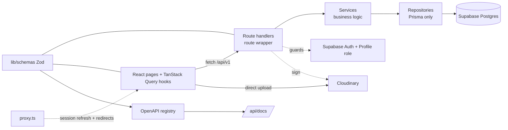

# Hackathon Base

Problem-agnostic starter: auth with roles, layered API, generated API docs, image uploads.
No domain features. Build yours with [docs/ADD_A_FEATURE.md](docs/ADD_A_FEATURE.md).

## Stack

Next.js (App Router, Cache Components) · TypeScript (strict) · Tailwind 4 · shadcn/ui · TanStack Query ·
Supabase Postgres + Prisma 6 · Supabase Auth · Zod · zod-to-openapi + Scalar · Cloudinary · Vitest · Vercel.

> This Next.js version renames `middleware` to `proxy` (`proxy.ts`) and enables `cacheComponents`:
> anything reading cookies must sit behind `<Suspense>`. Read `node_modules/next/dist/docs/` first.

## Architecture

Layers: `app/api/v1` (thin) → `server/services` (logic) → `server/repositories` (Prisma). Shared Zod schemas in `lib/schemas`.

## Setup

1. `npm install` (also runs `prisma generate`)
2. `cp .env.example .env.local` and fill every value (see comments inside).
3. Supabase: create a project, turn **off** "Confirm email" (Authentication → Providers → Email) for the demo.
4. `npm run db:push`
5. Create two users in Supabase (Authentication → Users), then
   `SEED_ADMIN_ID=<uuid> SEED_USER_ID=<uuid> npm run db:seed`
   (users who sign up normally get a `USER` profile automatically on first request).
6. `npm run dev` → http://localhost:3000, API docs at `/api/docs`.

## Scripts

| Script | Purpose |
| --- | --- |
| `dev` / `build` / `start` | Next.js |
| `typecheck` / `lint` / `test` | Quality gates |
| `check` | typecheck + lint + test + build |
| `db:push` / `db:migrate` / `db:seed` / `db:studio` / `db:generate` | Prisma |

## Deploy (Vercel)

Import the repo, add every variable from `.env.example` in Project Settings → Environment Variables, deploy.
`NEXT_PUBLIC_APP_URL` = the Vercel URL. Rate limiting is in-memory and per instance: swap for Upstash for production.
