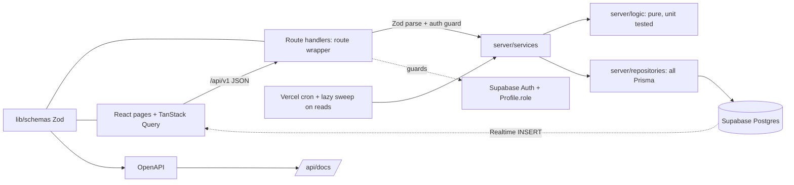

# FoodBridge

A government-run food-surplus matching platform. Givers (restaurants, caterers, homes, event hosts) post surplus food;
takers (institutions, charities, families) post needs. The system matches the nearest **safe and time-feasible** pair,
tracks the handover with a one-time code, rewards reliable givers, handles complaints, and gives the government
a console with live impact.

## Stack

Next.js (App Router, Cache Components) · TypeScript strict · Tailwind 4 + shadcn/ui · TanStack Query · react-hook-form + Zod ·
Supabase (Postgres, Auth, Realtime) · Prisma 6 · react-leaflet + OpenStreetMap · next/og posters · Cloudinary (optional) ·
Resend (optional) · Vitest · Vercel.

> This Next.js version renames `middleware` to `proxy` (`proxy.ts`) and enables `cacheComponents`: anything that reads
> cookies sits behind `<Suspense>`. Read `node_modules/next/dist/docs/` before changing framework-level code.

## Architecture

| Layer | Folder | Rule |
| --- | --- | --- |
| Route handlers | `app/api/v1/**` | thin: parse, guard, call service, `{data}` or `{error}` |
| Services | `server/services` | business rules, transactions, notifications |
| Pure logic | `server/logic` | no DB, no IO: safe-until, feasibility, match score, points, trust, escalation, OTP |
| Repositories | `server/repositories` | all Prisma access |
| Shared schemas | `lib/schemas` | one source of types for client and server |
| Pages | `app/(public)`, `app/(app)`, `app/(gov)` | landing + auth, giver/taker dashboards, government console |

Key rules implemented: cooked food safe 4 h (raw 24 h, packaged = printed expiry); feasible when `now + travel + 10 min <= expiry`
at 20 km/h; score `0.35 proximity + 0.25 time + 0.15 quantity + 0.10 diet + 0.10 trust + 0.05 fairness`; radius 3 → 6 → 10 km at 50 % / 75 %
of the window, government alert at 80 %; 15 min reservation hold; one active claim per offer (row lock **and** partial unique index);
OTP is HMAC-derived (giver can re-read it), only its SHA-256 is stored; exact address/phone only to the two parties of an ACCEPTED claim.
Time-based work (expiry, hold release, escalation) runs lazily on reads (throttled) and from `/api/v1/cron/tick`.

## Setup

1. `npm install` (runs `prisma generate`).
2. Create a Supabase project. In **Authentication → Sign In / Providers → Email** you can leave "Confirm email" on or off:
   signup goes through the server (`/api/v1/auth/signup`), which creates confirmed users.
3. `cp .env.example .env.local` and fill every non-optional value (see comments in the file).
4. Database schema: already applied with the migration in `prisma/migrations/0001_init/migration.sql`
   (includes the partial unique index, RLS, the notifications policy and the realtime publication).
   On a fresh project run that file in the Supabase SQL editor, or `npm run db:migrate`.
5. `npm run db:seed` creates the demo data and Supabase Auth users (needs the real **service_role** key).
6. `npm run dev` → http://localhost:3000 · API docs at `/api/docs` · OpenAPI JSON at `/api/openapi.json`.

## Demo accounts (after seeding)

Password for **all** seeded accounts: `FoodBridge#2026`

| Role | Email |
| --- | --- |
| Government | `gov@foodbridge.demo` |
| Givers | `spice.route@`, `paragon.cater@`, `beachside@`, `anitha.home@`, `ravi.events@`, `cafe.mocha@`, `sunil.home@`, `grand.cater@` `foodbridge.demo` |
| Takers | `snehadeepam@`, `oldage.home@`, `annadanam@`, `hostel.girls@`, `family.nair@`, `family.salim@`, `hope.centre@`, `ashraya@` `foodbridge.demo` |

## Demo script (5 minutes)

1. **Landing** (logged out): live posts with ticking rings, filters, counters. Click Contact → login modal.
2. **Taker** `annadanam@…`: dashboard feed ranked by match score ("Reachable in 12 min, 1h 40m left"). Request a post.
3. **Giver** `paragon.cater@…` (other window): claims inbox shows the request with a hold countdown → Accept → the OTP card appears.
4. **Claim screen**: countdown ring, "Why this match" six-factor bars, map with both pins and ETA, exact address now revealed.
5. **Taker** enters the OTP → confetti, giver gets points and a downloadable certificate with a verify QR (`/verify/{id}`).
6. **Trust**: taker rates the giver; file two complaints against `grand.cater@…` (already has two) → auto-suspended, banner + "Submit appeal".
7. **Government** `gov@…`: overview KPIs and chart, live map (red pulsing = unmatched/expiring), users, complaints, approve the appeal, config.

## Scripts

| Script | Purpose |
| --- | --- |
| `dev` / `build` / `start` | Next.js |
| `typecheck` / `lint` | quality gates |
| `test` / `test:ci` | Vitest (integration tests skip without `DATABASE_URL`) |
| `check` | typecheck + lint + test + build |
| `db:generate` / `db:push` / `db:migrate` / `db:seed` / `db:studio` | Prisma (loads `.env.local`) |

## Deploy (Vercel)

Import the repo, add every variable from `.env.example`, deploy. `vercel.json` runs `/api/v1/cron/tick` every 5 minutes
(Vercel sends `Authorization: Bearer $CRON_SECRET`). Rate limiting is in-memory and per instance: swap for Upstash in production.

## Adding a feature

See [docs/ADD_A_FEATURE.md](docs/ADD_A_FEATURE.md).
